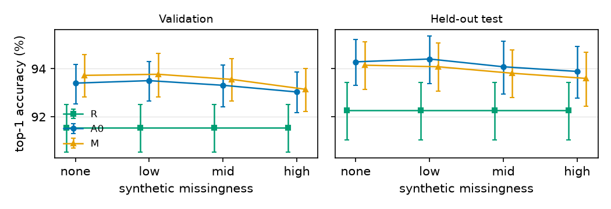
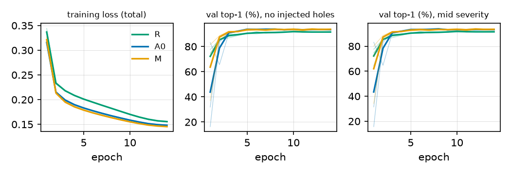
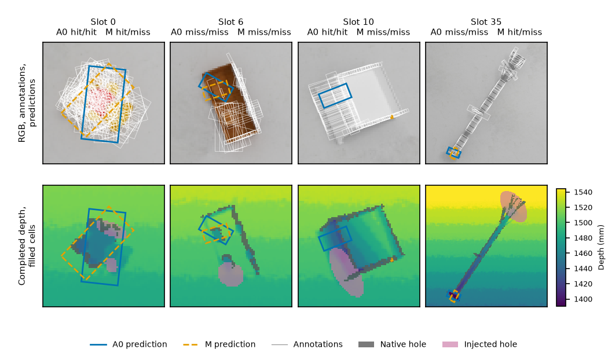

# When Depth Sensors Lie

Code for the course project report *When Depth Sensors Lie*: a measurement study of depth-validity flags in
lightweight RGB-D grasp detection on Jacquard v2.
Stereo depth sensors flag pixels they could not measure; grasp pipelines fill (inpaint) the flagged pixels,
so the flag is the only record of where the depth was made up. We train small (< 1M parameter) pixel-wise
grasp detectors that see RGB only (R), RGB + completed depth (A0), or RGB + completed depth + the flag (M),
and measure, among other things, whether the flag helps when synthetic holes are added (H1).

| Section | What it is for |
| --- | --- |
| [Results at a glance](#results-at-a-glance) | the primary result and the report's figures |
| [1. Demo / inference](#1-demo--inference-start-here) | run the trained detectors on the shipped sample scenes (minutes, CPU) |
| [2. Repository layout](#2-repository-layout) | the purpose of every file |
| [3. Data](#3-data) | Jacquard v2 facts and conventions |
| [4. Training process](#4-training-process) | how the detectors were trained, step by step, with the exact commands |
| [5. Recreating every result](#5-recreating-every-result) | every table and figure of the report, from the shipped checkpoints |

## Results at a glance
| Split | M - A0 at mid severity (primary contrast) | 95 % CI | 90 % CI |
| --- | --- | --- | --- |
| validation | +0.25 pp | [-0.51, +1.05] | [-0.38, +0.91] |
| held-out test | -0.27 pp | [-1.08, +0.55] | [-0.94, +0.40] |

Both 90 % intervals lie inside the pre-specified ±3-point equivalence margin. Every number and figure here is
recreated by Section 5.


*Top-1 annotation-match accuracy of R, A0 and M in the four missingness conditions, seeds pooled, with 95 %
bootstrap intervals. Left: validation; right: held-out test.*


*Training loss and validation top-1 per epoch for the nine final runs (thin lines: seeds; thick: mean).*


*The report's Fig. 3: A0 (blue) and M (orange, dashed) top-1 grasps on four mid-severity validation scenes,
seed 1. Top: RGB with all annotations (white); bottom: the completed depth with native (grey) and injected
(pink) holes.*

## 1. Demo / inference (start here)

**`demo.py` is the demo / inference script.** It needs no dataset download: the sample data and the trained
checkpoints are in `demo_data/`.

### Setup
Python 3.11 (Linux tested); a GPU is optional.
```bash
git clone https://github.com/Go-Ash43/Depth-Grasp-Analysis.git
cd Depth-Grasp-Analysis
python3 -m venv .venv && source .venv/bin/activate
pip install -r requirements-lock.txt --extra-index-url https://download.pytorch.org/whl/cu132
```
The lock file pins the exact versions used for the report (CUDA 13.2 PyTorch build). For a CPU-only demo,
any recent `torch`, `numpy`, `opencv-python-headless` and `matplotlib` also work; `--check` (below) then tells
you whether the results still match.

### Run
```bash
python demo.py --out demo_out                  # 4 sample scenes x 4 conditions x 3 detectors (~1 min on CPU)
python demo.py --out demo_check --check        # same, and compare with the report's recorded evaluation
```
`--check` must end with `PASS`: every prediction has the same top-1 cell, validity and match outcome as the
validation evaluation in the report, and the angle, opening and Q agree within `--check-tol` (1e-3).

Other options (`python demo.py --help`): `--holes none|low|mid|high` (one condition), `--models R,A0,M`,
`--device cuda`, `--no-figures`, and `--scene <Jacquard>/<part>/<object_id> --view N` to run on any other
Jacquard v2 scene (clean condition only).

### What it does (per scene; the same functions the evaluation used)
1. Loads the raw Jacquard files: RGB, simulated stereo depth (`-1` = undetermined), object mask, grasps.
2. Preprocesses them with the cache builder's own function: clamp, resize to 224 px, Telea completion of the
   flagged pixels (`scripts/build_cache.py`, frozen values in `configs/frozen_day1.json`).
3. Applies the condition: `none` = the sensor's own holes; `low` / `mid` / `high` add synthetic holes on the
   object with the evaluation's fixed corruption seed, re-complete the depth, and flag sensor + synthetic holes.
4. Runs R, A0 and M (training seed 1, final epoch), decodes the top-1 grasp and scores it against the
   annotations (primary: angle within 30 deg and IoU > 0.25; strict: 15 deg and IoU > 0.40).

### Outputs (in `--out`)
| File | Content |
| --- | --- |
| `predictions.csv` | one row per scene, condition and detector: grasp (x, y, theta, opening, jaw at 1024 px), Q, top-1 cell, primary / strict match |
| `<scene>.png` | one row per condition. Left: RGB, annotations (white, RGB panel only), each detector's grasp (R green dotted, A0 blue, M orange dashed), hit / miss in the title. Right: the completed depth the RGB-D detectors received; sensor holes grey, synthetic holes magenta |
| `demo_config.json` | the options, package and config hashes, software versions, git commit, and the `--check` report |

The four sample scenes are the validation cases shown in the report's Fig. 3. They were chosen to illustrate
hits and misses, so their accuracy is not representative of the full evaluation (Section 5).

### `demo_data/` (the demo package)
| Path | Content |
| --- | --- |
| `sample_data/<object_id>/` | four unmodified Jacquard v2 validation scenes (`<view>_<object_id>_{RGB.png, stereo_depth.tiff, perfect_depth.tiff, mask.png, grasps.txt}`); perfect depth is read by the preprocessing but never reaches a detector |
| `samples.json` | scene and checkpoint sha256, config sha256, and the recorded predictions `--check` compares against |

The detectors are the seed-1 final checkpoints in `artifacts/checkpoints/` (Section 5).

It was built with `scripts/make_demo_package.py`, which also verifies that the demo's preprocessing of each
sample scene reproduces the training/evaluation cache bit for bit.

## 2. Repository layout

| Path | Purpose |
| --- | --- |
| `readme_figures/` | PNG copies of the report figures shown in this README |
| **`demo.py`** | **demo / inference script (Section 1)** |
| `demo_data/` | sample scenes and recorded predictions for the demo |
| `artifacts/checkpoints/` | the nine final checkpoints (R, A0, M x seeds 1-3) behind every result |
| `artifacts/logs/` | the nine runs' epoch logs (training curves) |
| `artifacts/records/` | the recorded H1 outputs, accuracy summaries and per-scene file hashes (val, test_module) |
| `artifacts/manifests/` | sha256 manifests of the val and test_module caches |
| `artifacts/artifacts.json` | sha256 of every file in `artifacts/` and the recorded identities |
| `requirements-lock.txt` | exact package versions used for every run |
| **configs/** | |
| `configs/paths.json` | placeholder machine paths (dataset, cache, runs, manifests); override with `DEPTH_LIES_PATHS` |
| `configs/splits.json` | the frozen object-level train / val / test split |
| `configs/frozen_day1.json` | preprocessing values frozen after the data audit (lie threshold, depth clamp, Telea radius, normalisation) |
| `configs/train_data.json` | training data: synthetic-hole severities, augmentation, RGB normalisation, corruption seed |
| `configs/labels.json` | training targets, top-1 decoding and the match rule (primary / strict) |
| `configs/train_v1.json` | the frozen training configuration (model, loss, optimiser, schedule, 14 epochs, seeds 1-3) |
| `configs/train_v1_sq.json` | the pilot's alternative loss configuration |
| `configs/legacy_hashes.json` | content hashes linking the configs to the hashes recorded by the cache and runs |
| **data/** | |
| `data/jacquard.py` | Jacquard v2 scene loader and grasp parser |
| `data/geometry.py` | pixel-coordinate convention (pixel centres, scaling) used by every loader, decoder and metric |
| `data/mask_ops.py` | mask resizing and depth completion (Telea); all masks 1 = invalid |
| `data/lies.py` | natural stereo "lies" (flag says valid, depth is wrong) and the input depth clamp |
| `data/holes.py` | synthetic holes for training and for the H1 evaluation conditions |
| `data/labels.py` | training targets at 224 px (Q, cos 2θ, sin 2θ, width) |
| `data/decode.py` | top-1 grasp from the predicted maps |
| `data/dataset.py` | detector dataset over the 224-px cache (inputs per model, holes, flag) |
| `data/cache_layout.py` | layout and reader of the 224-px preprocessing cache |
| `data/augment.py` | training augmentation (none in the frozen configuration; flip supported) |
| `data/flag_edits.py` | flag-only interventions for the Protocol A invariant |
| `data/zones.py` | jaw-contact zones and controls (diagnostics) |
| `data/paths.py`, `data/provenance.py`, `data/workers.py` | machine paths, run provenance (git state, config hashes), DataLoader worker setup |
| **models/** | |
| `models/grconv_lite.py` | GRConvLite, the < 1M-parameter detector for R / A0 / M / A* |
| `models/losses.py` | training loss |
| **training/** | |
| `training/loop.py` | one training epoch |
| `training/checkpoint.py` | checkpoints, epoch log, crash recovery and resume |
| `training/runcfg.py` | run configuration and guards (clean tree, frozen config, budgets) |
| `training/env.py` | environment record (package versions, hardware) for exact-continuation checks |
| **eval/** | |
| `eval/match.py` | match of a predicted grasp against the annotations |
| `eval/val_epoch.py` | per-epoch validation: decode, match, miss categories |
| `eval/invariants.py` | Protocol A invariant (flag-only edits leave R and A0 bit-identical) |
| `eval/metric_policy.py` | primary / strict metric promotion rule |
| `eval/h1.py` | H1 statistics (paired two-level bootstrap, equivalence test) |
| **scripts/** (data pipeline) | |
| `scripts/make_manifest.py` | inventory of every Jacquard v2 scene |
| `scripts/make_split.py` | the object-level split (run once) |
| `scripts/audit_train.py`, `scripts/audit_report.py` | training-split audit and the frozen values derived from it |
| `scripts/check_angle_convention.py` | real-data check of the grasp-angle convention |
| `scripts/build_cache.py` | builds the 224-px preprocessing cache |
| `scripts/check_cache_totals.py`, `scripts/accept_cache.py` | cache acceptance checks |
| `scripts/cache_manifest.py` | sha256 manifest of a cache: prove a copy on another machine is exact |
| `scripts/overlays.py`, `scripts/zone_diagnostics.py` | data diagnostics and overlays |
| **scripts/** (training) | |
| `scripts/train.py` | trains one detector (Section 4) |
| `scripts/gate_protocol_a.py` | Protocol A gate on real checkpoints |
| `scripts/pilot_compare.py` | pilot analysis: loss configuration and training budget |
| **scripts/** (evaluation and figures) | |
| `scripts/metric_decision.py` | records the metric decision from A0 seed 1 |
| `scripts/m1_runs.py` | run integrity checks and run selection |
| `scripts/eval_m1.py` | evaluation of the selected checkpoints on val or test_module |
| `scripts/h1_harness.py` | H1 tables and statistics from an evaluation |
| `scripts/reproduce.py` | recreates the evaluation, the accuracy table and every H1 number from `artifacts/` and a cache (Section 5) |
| `scripts/make_paper_figures.py` | the accuracy-vs-missingness figure and the training curves |
| `scripts/make_fig3.py` | the report's Fig. 3 grasp overlays and the saved-cases table |
| `scripts/export_artifacts.py` | builds `artifacts/` from the recorded runs |
| `scripts/make_demo_package.py` | builds `demo_data/` |
| `scripts/dummy_runs.sh` | runs every pipeline command on tiny inputs and compares with the recorded outputs |
| **tests/** | pytest suite (`python -m pytest tests -q`): conventions, preprocessing, model, metrics, statistics, recovery |

## 3. Data
- Jacquard v2: 51,601 scenes in 12 parts, all with RGB, mask, grasps, perfect and stereo depth.
- Layout: Jacquard_Dataset_<part>/<object_id>/<scene>_<object_id>_{RGB.png, mask.png, grasps.txt, perfect_depth.tiff, stereo_depth.tiff}
- Depth: float32, metres (~1.5 m camera distance; checked on one scene, then on the full dataset audit).
- Stereo invalid pixels = -1. Perfect depth has no holes.
- Mask convention everywhere: 1 = invalid.

### Reference code
- skumra/robotic-grasping, utils/ only, commit 183c6f68c44c1c7ff0f07707e2db6fcfd6840d2d
  (Jacquard parser and rectangle IoU; the model is not used).
- Ported, never imported: it uses `np.int`/`np.float`, removed in the pinned NumPy (2.x), so it
  raises AttributeError if run unchanged. `tests/test_angle.py` holds a line-by-line port of
  `Grasp.as_gr` and the Jacquard line loader.

### Decisions
- Module 6b (simulated grasp trials) dropped: no simulator access.
- Small objects at 224 px: crop / size threshold fixed in the Phase 0 audit.

## 4. Training process

### Overview
1. **Data pipeline (once).** Inventory and split Jacquard v2 by object; audit the training split to freeze the
   preprocessing values (`configs/frozen_day1.json`); build the 224-px cache: per scene RGB, stereo depth
   clamped and completed with Telea over the sensor's flagged pixels, the flag `M_sensor`, perfect depth
   (A* and diagnostics only) and the grasp annotations.
2. **Model.** GRConvLite (`models/grconv_lite.py`, < 1M parameters, trained from scratch) predicts per-pixel
   grasp quality Q, angle (cos 2θ, sin 2θ) and width. Inputs: R = RGB; A0 = RGB + completed depth; M = A0 +
   flag channel; A* = RGB + perfect depth (reference only).
3. **Training data.** Each training sample gets synthetic holes on the object with a fixed probability and a
   random severity (`configs/train_data.json`); the depth is re-completed over all holes, and M's flag marks
   them. No augmentation in the frozen configuration.
4. **Optimisation** (`configs/train_v1.json`, frozen). Smooth-L1 loss on the four maps, Adam (lr 1e-3), cosine
   schedule per step, batch 32, 14 epochs, float32 without AMP, seeds 1-3 per model. Every epoch writes a
   checkpoint, a validation CSV (clean and mid-severity holes) and a log line with sha256 hashes; an
   interrupted run resumes exactly.
5. **Sanity gates and pilot.** P0 smoke runs (resume, Protocol A), P1 timing to set the epoch budget, P2/P3
   pilot comparing the two loss configurations; then the configuration was frozen.
6. **Production.** R, A0 and M with seeds 1, 2, 3 (`--kind production` refuses a draft configuration or a dirty tree).
7. **After training.** Metric decision, run selection, evaluation and H1 (Section 5).

### Retraining on your own machine (short path)
The configuration is frozen (`configs/train_v1.json`), so the pilot below (P0-P3) is not needed again: it
documents how that configuration was chosen. Retrained models will not be bit-identical to the shipped ones
on other hardware; compare your H1 results with the report's within their confidence intervals. Set up the
paths file first (Paths, below), and put the test cache in place (Section 5, Step 1).
```bash
export DEPTH_LIES_PATHS=~/depth_lies_paths.json; R=/path/to/runs          # R = runs_dir of the paths file
python scripts/make_manifest.py \
 && python scripts/build_cache.py --splits train,val --workers 8 \
 && python scripts/cache_manifest.py write --splits train,val --out $R/cache_manifest_v1 \
 && python scripts/cache_manifest.py write --splits test_module --out $R/cache_manifest_test_module \
 && python -m pytest tests -q && [ -z "$(git status --porcelain)" ]       # production refuses a dirty tree
for s in 1 2 3; do for m in A0 R M; do                                    # 9 runs x 14 epochs
  python scripts/train.py --kind production --model $m --seed $s --manifest $R/cache_manifest_v1/manifest.json \
      --device cuda --out $R/${m}_s$s || break 2
done; done
```
The cache build takes ~3 h and ~51 GB; each run takes 14 epochs (on an RTX 3050 Laptop GPU with the cache on
NVMe, an estimated 4-5 h per run). An interrupted run continues with the same command plus `--resume`.
Then evaluate your runs with the same chain the report used (all from the same commit, no commit in between):
```bash
C=$(git rev-parse --short=7 HEAD); MD=$R/metric_decision/metric_decision.json
TM=$R/cache_manifest_test_module/manifest.json; S=$R/m1_selection/selected_runs.json
python scripts/metric_decision.py --a0-run $R/A0_s1 --out $R/metric_decision \
 && python scripts/m1_runs.py --runs-root $R --commit $C --m3-laptop $R/M_s3 --metric-local $MD --metric-pod $MD \
        --out $R/m1_selection \
 && python scripts/eval_m1.py --selected $S --split val --manifest $R/cache_manifest_v1/manifest.json \
        --out $R/m1_eval_val \
 && python scripts/h1_harness.py --selected $S --split val --eval-dir $R/m1_eval_val --metric-local $MD \
        --out $R/m1_h1_val \
 && python scripts/eval_m1.py --selected $S --split test_module --manifest $TM \
        --expect-manifest-sha256 $(sha256sum $TM | cut -d' ' -f1) --out $R/m1_eval_test \
 && python scripts/h1_harness.py --selected $S --split test_module --eval-dir $R/m1_eval_test --metric-local $MD \
        --out $R/m1_h1_test
```
`--metric-pod` takes the same record on a single machine (the report's runs used two machines, whose records
had to agree); M seed 3 is passed with `--m3-laptop`. `eval_m1.py` allows the test split once per runs folder.
The results land in `$R/m1_h1_val/` and `$R/m1_h1_test/` (`h1.json`, `h1_tables.md`), in the same format as
`artifacts/records/`. This path has not been run end to end on a fresh machine; the scripts' own checks stop
with a message naming the problem if something does not match.

### Full execution plan
The blocks below are the full plan as executed, including the pilot that chose the frozen configuration.
Every script: `--help` for all options.
`scripts/dummy_runs.sh` runs every pipeline command on tiny inputs and compares against recorded outputs.
The commands assume one workstation with one CUDA GPU; run P1, P2, P3 and production on the same GPU type.

### Paths (every shell)
`configs/paths.json` holds placeholders only. Write your machine's paths to a JSON file OUTSIDE the repo
and export it in EVERY shell before running any script (keys left out fall back to the placeholders):
```bash
cat > ~/depth_lies_paths.json <<'EOF'
{"data_root": "/path/to/jacquard", "cache_dir": "/path/to/cache", "manifest_dir": "/path/to/manifests",
 "runs_dir": "/path/to/runs"}
EOF
export DEPTH_LIES_PATHS=~/depth_lies_paths.json
```

### Data pipeline (done once; in order)
```bash
export DEPTH_LIES_PATHS=~/depth_lies_paths.json
RUNS=/path/to/depth-lies/runs                        # = runs_dir of the paths file
python scripts/make_manifest.py                      # --limit 200 for a quick test; --full also decodes
python scripts/make_split.py                         # seed 0; --dry-run prints counts only
python scripts/audit_train.py --workers 8            # --max-scenes 200 --out <dir> for a smoke run
python scripts/audit_report.py --audit-dir $RUNS/audit_train_5k
python scripts/check_angle_convention.py             # 12 random scenes, seed 0
python scripts/build_cache.py --workers 8            # train, val, test_module (long)
python scripts/check_cache_totals.py
python scripts/accept_cache.py --out $RUNS/accept_cache_v1
python scripts/overlays.py --out $RUNS/overlays_v1
python scripts/zone_diagnostics.py --n-scenes 2000 --seed 0
python scripts/cache_manifest.py write --splits train,val --out $RUNS/cache_manifest_v1
```

### Before any pilot or production run
```bash
python -m pytest tests -q          # all must pass
git status                         # must be clean: pilot / production refuse a dirty tree (smoke: --allow-dirty)
```

### Workstation: optional, cache on the internal NVMe (needs ~54 GB free)
On the USB HDD the cache reads at ~88 ms/sample (~68 min per epoch: P1 would exceed the 45-min limit).
On NVMe the RTX 3050 becomes the limit instead (estimated ~16-22 min per epoch; P1 measures it).
```bash
mkdir -p ~/dl_cache
rsync -a --info=progress2 /path/to/depth-lies/cache/train /path/to/depth-lies/cache/val ~/dl_cache/
python scripts/cache_manifest.py verify --manifest $RUNS/cache_manifest_v1/manifest.json \
    --cache-dir ~/dl_cache --workers 4 --out $RUNS/manifest_verify_nvme          # must PASS
sed "s#\"cache_dir\": \"[^\"]*\"#\"cache_dir\": \"$HOME/dl_cache\"#" ~/depth_lies_paths.json > ~/depth_lies_paths_nvme.json
```

### Workstation: every shell
Run from tmux with VS Code closed (the first local pilot was killed by systemd-oomd).
```bash
tmux new -s main                   # later: tmux attach -t main
cd Depth-Grasp-Analysis
export DEPTH_LIES_PATHS=~/depth_lies_paths.json     # with the NVMe cache: ~/depth_lies_paths_nvme.json
R=/path/to/depth-lies/runs; M=$R/cache_manifest_v1/manifest.json    # R = runs_dir of the paths file
CACHE=/path/to/depth-lies/cache                     # = cache_dir of the paths file (~/dl_cache with NVMe)
W=2; WS=2; HW=1                    # loader workers (pilot, smoke), cache re-hash threads (HW=8 on NVMe)
```

### P0 sanity (both arms, resume, Protocol A)
USB HDD: ~1.5-2 h (each start re-hashes the 54 GB cache ~11 min, then validates 5,162 scenes ~10 min).
```bash
S="--kind smoke --seed 1 --limit-train 512 --batch-size 8 --num-workers $WS --hash-workers $HW --progress-every 16 --manifest $M --device cuda"
python scripts/train.py $S --model A0 --epochs 1 --out $R/p0_smoke_cfg
python scripts/train.py $S --model A0 --epochs 1 --config configs/train_v1_sq.json --out $R/p0_smoke_sq
# resume test: interrupt right after epoch 0 is committed, resume, compare with an uninterrupted run
python scripts/train.py $S --model A0 --epochs 2 --out $R/p0_smoke_resume & PID=$!
until grep -q "^epoch 0:" $R/p0_smoke_resume/console.log 2>/dev/null; do sleep 1; done; kill -INT $PID; wait $PID
python scripts/train.py $S --model A0 --epochs 2 --out $R/p0_smoke_resume --resume
python scripts/train.py $S --model A0 --epochs 2 --out $R/p0_smoke_2ep
sha256sum $R/p0_smoke_2ep/val/epoch_001.csv $R/p0_smoke_resume/val/epoch_001.csv    # must be equal
python scripts/gate_protocol_a.py --ckpt-A0 $R/p0_smoke_cfg/ckpt/epoch_000.pt --n 64 --batch-size 8 \
    --out $R/p0_protocol_a --device cuda                                            # PASS
# R / M / Astar paths (before production)
for m in R M Astar; do
  python scripts/train.py $S --model $m --epochs 1 --config configs/train_v1_sq.json --out $R/p0_smoke_${m}_sq || break
done
python scripts/gate_protocol_a.py --ckpt-R $R/p0_smoke_R_sq/ckpt/epoch_000.pt \
    --ckpt-A0 $R/p0_smoke_sq/ckpt/epoch_000.pt --ckpt-M $R/p0_smoke_M_sq/ckpt/epoch_000.pt \
    --n 64 --batch-size 8 --out $R/p0_protocol_a_RA0M --device cuda
```

### P1 timing -> E
P1 must run on the machine that runs P2, P3 and production: E is a time budget for that hardware.
```bash
python scripts/train.py --kind smoke --model A0 --seed 1 --epochs 1 --config configs/train_v1_sq.json \
    --num-workers $W --hash-workers $HW --manifest $M --out $R/p1_timing_sq --device cuda
T=$(grep -o '"epoch_wall_s": [0-9.]*' $R/p1_timing_sq/log.jsonl | awk '{print $2}')
E=$(python -c "import math,sys; T=float(sys.argv[1]); assert T <= 2700, 'T > 45 min: stop for a manual decision'; print(max(2, math.floor(5400/T)))" $T)
echo "T=$T s  E=$E  2E=$((2*E))"
```
Expected: USB HDD T ~68 min (stops: T > 45 min); NVMe T ~16-22 min (estimate) -> E ~4-5;
a faster GPU gives a smaller T and a larger E.

### P2 + P3 (the pilot)
```bash
P="--kind pilot --model A0 --seed 1 --num-workers $W --hash-workers $HW --manifest $M --device cuda"
python scripts/train.py $P --epochs $E --out $R/p2_A0_cfg_E$E \
 && python scripts/train.py $P --epochs $E --config configs/train_v1_sq.json --out $R/p2_A0_sq_E$E \
 && python scripts/train.py $P --epochs $((2*E)) --config configs/train_v1_sq.json --out $R/p3_A0_sq_2E$((2*E))
```
Time: 4 x E x T in total (NVMe estimate with E = 4-5: ~5-6 h). The P3 line prints "WARNING: projected
... exceeds the 90-min budget": expected, 2E is meant to exceed it. Keep P1-P3 on one machine / GPU type.

### Pilot decisions (after all three runs print `done:`)
```bash
python scripts/pilot_compare.py --config-arm $R/p2_A0_cfg_E$E --sq-arm $R/p2_A0_sq_E$E \
    --sq-2e $R/p3_A0_sq_2E$((2*E)) --cache-dir $CACHE --out $R/pilot_compare
```
CONFIG_WINS, BUDGET_TOO_SHORT or NARROW_DOMINATES -> manual decision; otherwise SQ at E epochs.
Then P4: Protocol A on the chosen A0, the config freeze, production.

### Production (only after the config is frozen; `--kind production` refuses a draft config)
```bash
for s in 1 2 3; do for m in A0 R M; do
  python scripts/train.py --kind production --model $m --seed $s --num-workers $W --hash-workers $HW \
      --manifest $M --device cuda --out $R/${m}_s$s || break 2
done; done
```
Epochs and the allowed seeds come from the frozen config. Split the list across machines of the same GPU
type to run in parallel.

### Situations
| Situation | What to do |
| --- | --- |
| Watch a run | `tail -f $R/<run>/console.log`; GPU: `watch -n 5 nvidia-smi` (Ctrl-b then " for a second tmux pane) |
| All epoch results so far | `grep "^epoch" $R/<run>/console.log` |
| Snapshot of the pilot | `for d in $R/p2_A0_* $R/p3_A0_*; do echo "== $d"; grep "^epoch" $d/console.log; done \| tee $R/pilot_snapshot_$(date +%H%M).txt` |
| Leave a run alone | detach tmux: Ctrl-b then d (NOT Ctrl-c). Back: `tmux attach -t main` (`tmux ls` lists sessions) |
| Close a tmux pane | Ctrl-c, then `exit`; or Ctrl-b then x, then y |
| Accidental Ctrl-c / crash / killed | the same `train.py` command plus `--resume` (continues after the last committed epoch; with none, restarts epoch 0 identically). The traceback is in `console.log` |
| Resume refused: "environment differs" | restore the original environment (same GPU type, driver, CPU count and thread settings). Module 1 production requires exact continuation; `--allow-env-change` marks the run `continuation_exact: false`, which makes it ineligible for selection |
| "run directory exists" on a fresh run | pick a new `--out`, or `--resume` if it is the same run |
| "dirty tree" refusal | commit first; `--allow-dirty` is for smoke runs only |
| Killed by systemd-oomd (workstation) | close VS Code / browsers, lower `W`, run from tmux; then `--resume` |
| "WARNING: projected ... exceeds the 90-min budget" | expected for P3 (2E); for a P2 arm or production it means epochs are slower than P1 measured: report it |

## 5. Recreating every result

Every number in the report comes from the nine final checkpoints in `artifacts/checkpoints/` (R, A0 and M,
training seeds 1-3), evaluated on the validation split and the held-out test split (`test_module`). This
section recreates all of them from those checkpoints. Retraining the checkpoints themselves is Section 4;
bit-identical retraining needs the same GPU type and software as the original runs.

### Before you start
- **Code.** `git clone` the repo (the checkpoints come with it, ~100 MB) and run every command below from the
  repo root (`cd Depth-Grasp-Analysis`) in the environment of Section 1 (Python 3.11, `requirements-lock.txt`).
  Build caches only in that locked environment: the cache bytes depend on the OpenCV and NumPy versions
  (resizing and Telea completion).
- **Hardware.** An NVIDIA GPU whose driver supports CUDA 13.2 (`nvidia-smi` shows the supported CUDA
  version). Tested on an RTX 3050 Laptop GPU with 4 GB, which is enough. `--device cpu` works but takes hours.
- **Disk.** Jacquard v2 extracted ~68 GB; validation cache 5.6 GB; test cache 3.4 GB (plus the 3.4 GB zip
  while unzipping); scene inventory 34 MB; outputs ~120 MB per split. Retraining (Section 4) also needs the
  45 GB training cache.
- **Quick checks first** (minutes, no dataset needed): `python -m pytest tests -q` and
  `python demo.py --out ~/dl_demo --check` (must print `PASS`).

### What the repo holds (`artifacts/`)
| Path | Content |
| --- | --- |
| `checkpoints/{R,A0,M}_s{1,2,3}.pt` | the nine final checkpoints (sha256 in `artifacts.json`) |
| `logs/{R,A0,M}_s{1,2,3}.jsonl` | the nine runs' epoch logs: training loss and per-epoch validation |
| `records/{val,test_module}/h1.json`, `h1_tables.md` | the recorded H1 results the reproduction is compared with |
| `records/{val,test_module}/eval_summary.json`, `eval_files.json` | the recorded per-run accuracies and per-scene file hashes |
| `manifests/cache_manifest_v1.json`, `manifests/cache_manifest_test_module.json` | sha256 of every cache file |

### Step 1: data
1. **Jacquard v2 (full dataset).** Obtain and install Jacquard v2 from its official distribution and extract
   every part into one folder, so that it directly contains `Jacquard_Dataset_0` ... `Jacquard_Dataset_11`
   (layout: `<jacquard>/Jacquard_Dataset_<part>/<object_id>/...`, Section 3). That folder is `data_root` below.
2. **The test cache.** Download `test_module.zip` (3.4 GB) from [GOOGLE DRIVE LINK](https://drive.google.com/file/d/1gO0h-H3dPBqCitiBfmnTLGdRB_gro2es/view?usp=drive_link) and unzip it into your
   cache folder:
   ```bash
   mkdir -p /path/to/cache && unzip test_module.zip -d /path/to/cache
   ```
   `/path/to/cache/test_module/` must then hold `COMPLETE`, `summary.json`, `index.csv` and the `*.npy` arrays.
   This is the exact cache the report's test evaluation used (only `summary.json` differs: the build's machine
   paths and start time are removed): the evaluation verified it against a manifest
   with the pre-registered sha256 `34c993195b9183d5fa0c3336226af49900631f0baf876da043ecd03b05b72ac8`;
   `artifacts/manifests/` holds that manifest's file list (identical file hashes, without the machine-specific
   fields), and `reproduce.py` checks the cache against it.
3. **Paths.** Create a JSON file outside the repo and point `DEPTH_LIES_PATHS` at it (`cache_dir` = the
   folder that holds `test_module/`; `manifest_dir` and `runs_dir` are created if missing):
   ```bash
   cat > ~/depth_lies_paths.json <<'EOF'
   {"data_root": "/path/to/jacquard", "cache_dir": "/path/to/cache", "manifest_dir": "/path/to/manifests",
    "runs_dir": "/path/to/runs"}
   EOF
   export DEPTH_LIES_PATHS=~/depth_lies_paths.json
   ```
   Every script reads its dataset, cache and manifest folders from this file: run the `export` line again
   in every new shell (Steps 2 and 3 repeat it).

### Step 2: build the validation cache from Jacquard v2
```bash
export DEPTH_LIES_PATHS=~/depth_lies_paths.json
python scripts/make_manifest.py                          # inventory of all 51,601 scenes (~30 min)
python scripts/build_cache.py --splits val --workers 8   # 5,162 scenes -> <cache>/val (5.6 GB, ~20 min)
```
`build_cache.py` refuses to run if the inventory does not hash to the one `configs/splits.json` was made from
(that would mean a different copy of the dataset). The same command with `--splits test_module` rebuilds the
test cache too (~13 min), if you prefer it to the download.

### Step 3: recreate the results (one GPU; ~30 min per split)
```bash
export DEPTH_LIES_PATHS=~/depth_lies_paths.json
O=~/depth_lies_out                                   # outputs, outside the repo
python scripts/reproduce.py --split val --out $O/repro_val \
 && python scripts/reproduce.py --split test_module --out $O/repro_test \
 && python scripts/make_paper_figures.py --h1-val $O/repro_val/h1.json --h1-test $O/repro_test/h1.json --out $O/figures \
 && python scripts/make_fig3.py --eval-dir $O/repro_val --out $O/figures/grasp-overlays.pdf
```
Each `reproduce.py` run must end with `PASS`. It
1. hashes the cache against the shipped manifest (`summary.json` differs for a rebuilt cache and for the
   downloaded one: it records the machine, commit and time of the build; every other file is reported);
2. evaluates the nine checkpoints in the four conditions with the evaluation's own code
   (`scripts/eval_m1.py`), writing the per-scene CSVs to `<out>/results/`;
3. writes `accuracy_table.md` and computes H1 with the analysis' own statistics (`scripts/h1_harness.py`:
   two-level crossed bootstrap, 10,000 resamples, fixed seed) into `h1.json` and `h1_tables.md`;
4. compares all three with the recorded results in `artifacts/records/`.
On a different GPU the per-scene CSVs can differ from the recorded bytes in the last digits; the match
outcomes, and therefore every reported number, must not.

### Where each result comes from
| Report item | Recreated by | Read it from |
| --- | --- | --- |
| Table I: object-disjoint partitions | `configs/splits.json` (rebuilt by `scripts/make_split.py`) | its `counts` field |
| Table II: input variants | `data/dataset.py` | `MODELS` |
| Table III and the architecture figure: GRConvLite layers | `models/grconv_lite.py` | layer definitions; `n_params`; `tests/test_model.py` |
| Development checks: clean A0 gate | `reproduce.py --split val` | `$O/repro_val/h1.json` -> `G1_clean_A0` |
| Table IV: primary contrast M - A0 at mid | `reproduce.py` | first row of `$O/repro_val/h1_tables.md` and `$O/repro_test/h1_tables.md` |
| Paired-effects figure (point, 95 % and 90 % intervals) | `reproduce.py` | `h1.json` -> `primary` (`point_pp`, `ci95`, `ci90`) of both splits |
| Table V: accuracy, primary / strict | `reproduce.py` | `$O/repro_val/accuracy_table.md`, `$O/repro_test/accuracy_table.md` |
| Table VI: descriptive contrasts and per-seed rows | `reproduce.py` | `h1.json` -> `secondary_no_verdict`, `per_seed_M-A0` |
| Accuracy across missingness figure | `make_paper_figures.py` | `$O/figures/severity-accuracy.pdf` |
| Training curves figure | `make_paper_figures.py` | `$O/figures/training-curves.pdf` (from `artifacts/logs/`) |
| Table VII: covered stereo errors | `reproduce.py --split test_module` | `$O/repro_test/h1.json` -> `covered_lie_mid` |
| Narrow grasps | `reproduce.py` | `h1.json` -> `misses_by_target_opening_no_verdict` |
| Table VIII: saved validation cases | `make_fig3.py` | `$O/figures/grasp-overlays.pdf.json` (per-slot outcomes) |
| Fig. 3: paired grasp overlays | `make_fig3.py` | `$O/figures/grasp-overlays.pdf` |

Expected primary results:

| Split | M - A0 at mid severity | 95 % CI | 90 % CI | Reading |
| --- | --- | --- | --- | --- |
| validation | +0.25 pp | [-0.51, +1.05] | [-0.38, +0.91] | equivalent within +/-3 pp |
| held-out test | -0.27 pp | [-1.08, +0.55] | [-0.94, +0.40] | equivalent within +/-3 pp |

### The recorded analysis chain
The records in `artifacts/records/` were made by `scripts/metric_decision.py`, `scripts/m1_runs.py`
(integrity of every training run and the run selection), `scripts/eval_m1.py` (with a one-look ledger for
the test split) and `scripts/h1_harness.py`. That chain checks every epoch checkpoint of every run against
its log and binds its records to the original machine's files, so it is included and documented in each
script's `--help`, but `reproduce.py` is the route for recreating the results elsewhere: it uses the same
evaluation and statistics code on the shipped final checkpoints.
